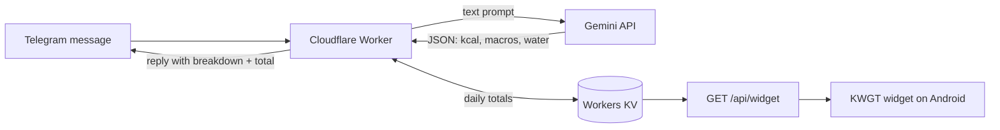

# Calorie Tracker Worker

A private, serverless calorie and macro tracker. Send a plain-text message to a Telegram bot ("two eggs and a slice of toast", "500 ml water"), and a Cloudflare Worker asks Google Gemini to estimate calories, macros and water intake, stores the daily totals in Workers KV, and replies with a summary. An Android home-screen widget (KWGT) shows today's progress as rings.

I built it for my own daily use, so it is single-user by design.

## Screenshots

| Logging a meal | Daily total | Logging water |
|---|---|---|
|  |  |  |

### Home-screen widget


The widget is a custom [KWGT](https://kustom.rocks/) layout with progress rings for calories, carbs, water and other daily totals. It polls the Worker's `/api/widget` endpoint. The widget file itself is not included in this repo because its export embeds the endpoint URL and secret.

## How it works



1. Telegram delivers each message to the Worker through a webhook.
2. The Worker checks the webhook secret header and that the sender is the configured user.
3. Commands (`/start`, `/total`, `/reset`) are handled directly.
4. Any other text is sent to Gemini, which is instructed to answer strictly in JSON (dish name, calories, protein, carbs, fat, water, per-item breakdown).
5. The values are validated, added to the day's totals in KV (`daily_<userId>_<YYYY-MM-DD>`, kept for 48 hours), and a formatted reply is sent back.
6. The widget calls `GET /api/widget?secret=...` and receives today's totals as JSON.

## Commands

| Command | What it does |
|---|---|
| any text | Logs a meal or drink (estimated by Gemini) |
| `/total` | Shows today's calories, water, protein, carbs, fat and meal count |
| `/reset` | Clears today's data |
| `/start` | Shows the help message |

## Widget API

`GET /api/widget?secret=<WEBHOOK_SECRET>`

```json
{
  "calories": 1450,
  "protein": 92,
  "carbs": 160,
  "fat": 48,
  "water_ml": 1500,
  "meals_count": 3
}
```

Wrong or missing secret returns `403`. Other methods return `405`.

## Configuration

Secrets are never stored in the repo. Set them in Cloudflare (or in `.dev.vars` for local development, see `.dev.vars.example`).

| Name | Type | Description |
|---|---|---|
| `CALORII_KV` | KV binding | Namespace that stores the daily totals |
| `TELEGRAM_BOT_TOKEN` | secret | Bot token from [@BotFather](https://t.me/BotFather) |
| `GEMINI_API_KEY` | secret | API key from [Google AI Studio](https://aistudio.google.com/) |
| `WEBHOOK_SECRET` | secret | Random string used for the Telegram webhook header and the widget URL (letters, digits, `_` and `-` only) |
| `MY_TELEGRAM_ID` | secret | Numeric Telegram user ID of the only person allowed to use the bot |

The Gemini model name and timezone are constants at the top of `worker.js` (`GEMINI_MODEL`, `TIMEZONE`).

## Setup

1. **Create the bot.** Talk to @BotFather, run `/newbot`, and copy the token.
2. **Create a KV namespace** and put its ID in `wrangler.toml` (replace `YOUR_KV_NAMESPACE_ID`):
   ```bash
   npx wrangler kv namespace create CALORII_KV
   ```
3. **Set the secrets:**
   ```bash
   npx wrangler secret put TELEGRAM_BOT_TOKEN
   npx wrangler secret put GEMINI_API_KEY
   npx wrangler secret put WEBHOOK_SECRET
   npx wrangler secret put MY_TELEGRAM_ID
   ```
4. **Deploy:**
   ```bash
   npx wrangler deploy
   ```
5. **Register the webhook** with the same secret you set above:
   ```bash
   curl "https://api.telegram.org/bot<TELEGRAM_BOT_TOKEN>/setWebhook" \
     -d "url=https://<your-worker>.workers.dev" \
     -d "secret_token=<WEBHOOK_SECRET>"
   ```
6. Message your bot with `/start`.

To find your numeric Telegram ID, message a bot such as @userinfobot.

## Security notes

- Only the Telegram user ID in `MY_TELEGRAM_ID` can use the bot; messages from anyone else are ignored.
- Telegram requests are accepted only if the `X-Telegram-Bot-Api-Secret-Token` header matches `WEBHOOK_SECRET`.
- Both checks fail closed: if a secret is not configured, requests are rejected.
- The Gemini key is sent in a request header, not in the URL, so it does not end up in logs.
- Numbers returned by the model are coerced and clamped to non-negative values before being added to the totals.

## Limitations

- Single user only.
- Calorie and macro values are model estimates, not exact measurements.
- Daily totals are updated with a read-modify-write on KV, which is not atomic. This is fine for one person sending one message at a time.
- The widget secret is passed as a query parameter, which is acceptable for personal use but not for a multi-user service.

## Tech stack

Cloudflare Workers, Workers KV, Telegram Bot API, Google Gemini API, KWGT, JavaScript.

## Note

Parts of this project were written with the help of an AI assistant. The idea, architecture, deployment, widget design and daily use are mine, and I reviewed and hardened the code (secret handling, input validation, access control) before publishing.